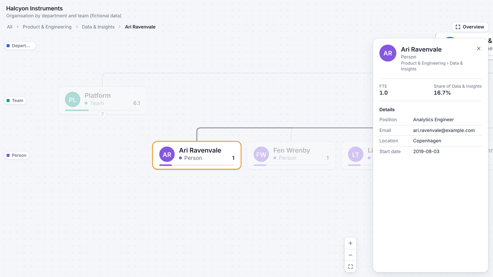
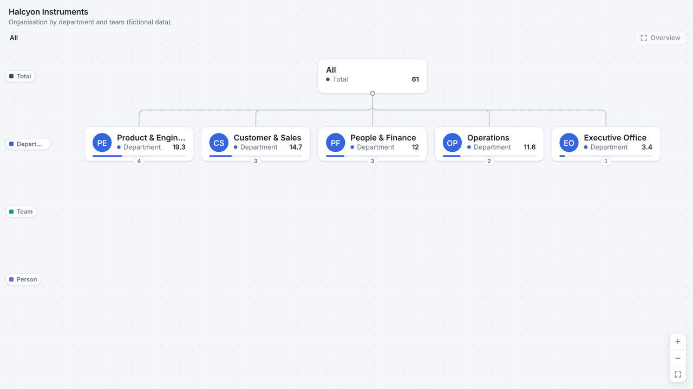
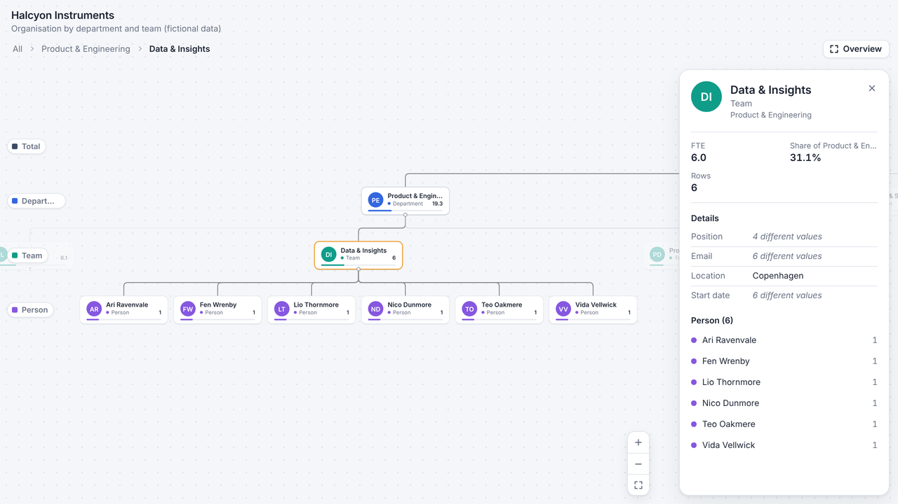
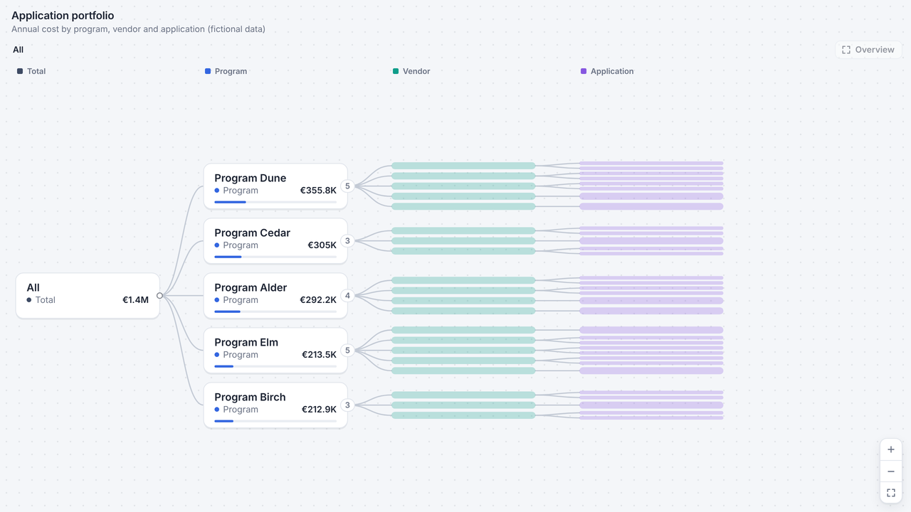

# Hierarchy Explorer for Power BI

An interactive hierarchy and org chart visual for Power BI. Click any node to zoom in and open
its branch, and see the details of a team or a person in a side panel.

## Features

- **Zoom into any branch.** Click a node to fly into it. Click it again to step back one level.
- **Two layouts.** A left-to-right decomposition tree, or a top-down org chart whose levels open as you enter them.
- **Details panel.** Show fields like position, email or location, with a clickable list of everyone below.
- **Share of parent.** A thin bar on every card shows its share of the level above.
- **Works like a built-in visual.** Cross-filtering, tooltips, right-click menu, bookmarks, keyboard navigation and high-contrast mode.

| Org chart | Entering a team | Left-to-right tree |
|---|---|---|
|  |  |  |

## Install

1. Download [`HierarchyExplorer-1.2.1.pbiviz`](HierarchyExplorer-1.2.1.pbiviz).
2. In Power BI Desktop, open the **Visualizations** pane, select **…** (Get more visuals), then
   **Import a visual from a file**, and choose the downloaded file.
3. A small tree icon appears in the Visualizations pane. Add it to your report.

## Fields

| Field well | What to add |
|---|---|
| **Hierarchy** | 1 to 8 fields, top level first, for example Department, Team, Person |
| **Value** | Optional measure, summed for every node. Without one, nodes show a row count. |
| **Details** | Optional fields shown in the details panel, for example Position, Email, Location |
| **Tooltips** | Optional extra measures for the tooltip |

Set **Format → Layout → Orientation** to *Vertical* for an org chart, and turn on
**Format → Nodes → Show initials** for people.

## Try it with example data

The [`examples`](examples) folder has two made-up datasets you can load with **Get data → Text/CSV**:

- **`showcase-org.csv`**: a fictional company of 65 people. Use Department, Team, Person as
  Hierarchy, FTE as Value, and Position, Email, Location, Start date as Details.
- **`showcase-portfolio.csv`**: fictional programs, vendors and applications. Use Program, Vendor,
  Application as Hierarchy, Annual cost as Value and Licences as Tooltips.

All names, companies and addresses in the examples and screenshots are invented.

## Privacy

The visual makes no network requests, stores nothing, loads no external resources and runs inside
Power BI's sandbox. It only sees the fields you add to it. The one exception is a value that is an
`https://` link in the details panel: it opens in your browser, but only when you click it.

## Source code

Everything needed to build the visual yourself is in the [`source`](source) folder.

## License

[MIT](LICENSE) © 2026 William Bøjstrup
